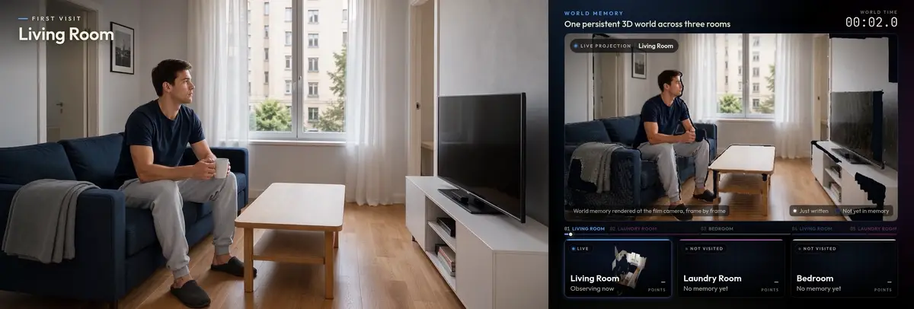
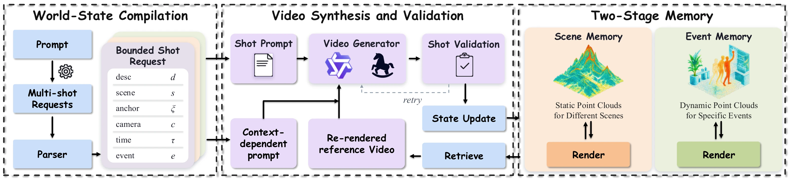
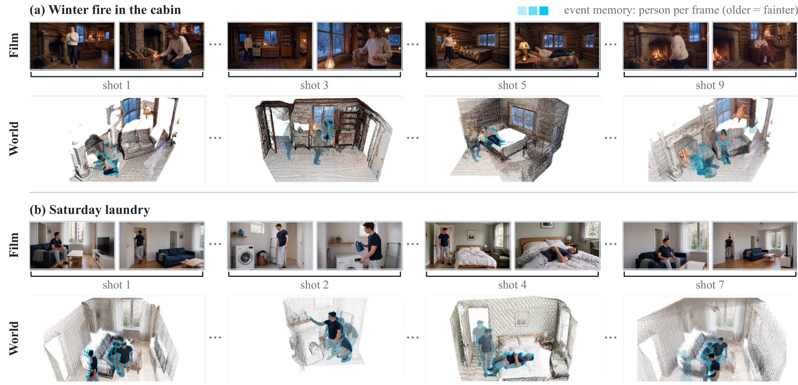
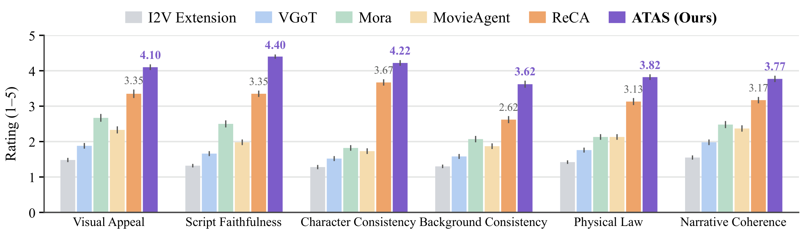
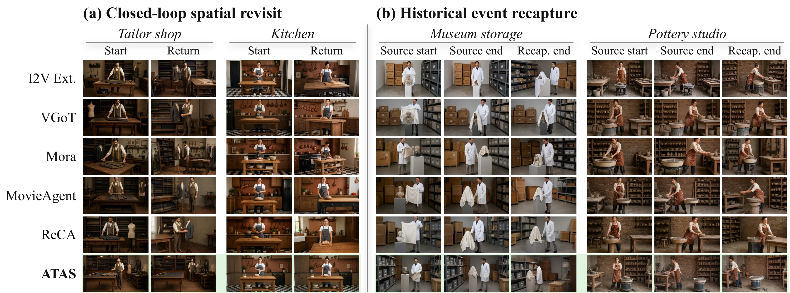
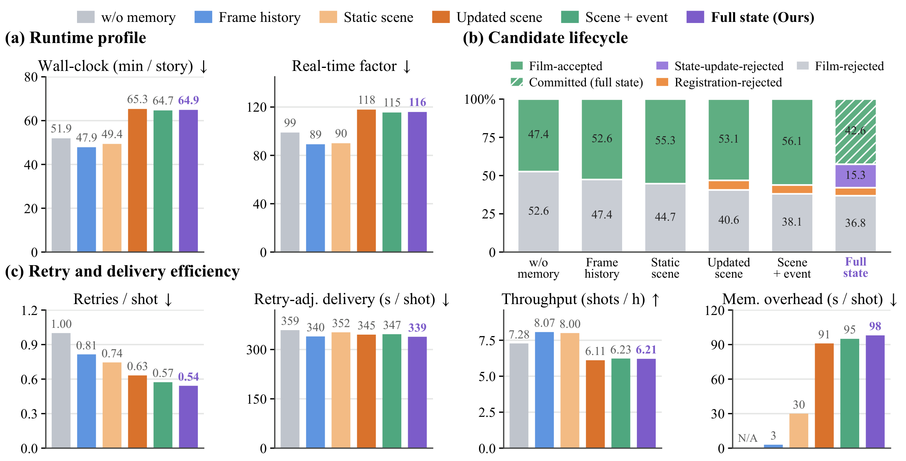

<div align="center">
  
</div>

<h1 align="center">Any Time, Any Space: A World-State-Centric Framework for Agentic Video Generation</h1>

<p align="center">
  <a href="https://arxiv.org/abs/2610.20571"></a>
  <a href="http://lhmd.top/atas"></a>
  <a href="https://github.com/ziplab/ATAS"></a>
  <a href="https://youtu.be/qsa63HUQzr4"></a>
</p>

<p align="center">
  <a href="https://lhmd.top/">Weijie Wang</a><sup>1,*</sup> &nbsp;
  <a href="https://zhmin.top/">Haomin Zhang</a><sup>1,*</sup> &nbsp;
  <a href="https://github.com/memoryoffish">Ye Li</a><sup>1,*</sup> &nbsp;
  <a href="https://github.com/AkideLiu">Akide Liu</a><sup>2</sup> &nbsp;
  <a href="https://steve-zeyu-zhang.github.io/">Zeyu Zhang</a><sup>3</sup> <br />
  <a href="https://zhao-haoyu.github.io/">Haoyu Zhao</a><sup>1</sup> &nbsp;
  <a href="https://hexy.tech/">Yefei He</a><sup>1</sup> &nbsp;
  <a href="https://donydchen.github.io/">Donny Y. Chen</a><sup>2</sup> &nbsp;
  <a href="https://github.com/Chenfeng1271">Feng Chen</a><sup>4</sup> &nbsp;
  <a href="https://bohanzhuang.github.io/">Bohan Zhuang</a><sup>1,†</sup>
</p>

<p align="center">
  <sup>1</sup>Zhejiang University &nbsp; &nbsp;
  <sup>2</sup>Monash University &nbsp; &nbsp;
  <sup>3</sup>BAIR, UC Berkeley &nbsp; &nbsp;
  <sup>4</sup>Adelaide University
</p>

<p align="center"><sup>*</sup>Equal contribution. &nbsp; <sup>†</sup>Corresponding author.</p>

<p align="center">
  <a href="https://net-oss.akclau.de/iclr2027-atas-demo/20260926/videos/saturday_laundry_in_the_flat.mp4"></a>
</p>

**ATAS keeps one persistent world behind a whole film.**<br>
Every shot is generated by projecting the world state into the requested view, and every generated shot is
reconstructed, registered and validated before it updates that world.

## Highlights

<table>
  <tr>
    <td width="50%"><b>🧭 World-State Compiler</b><br>A screenplay becomes bounded shot requests with explicit scene, camera, time and event.</td>
    <td width="50%"><b>🏠 Scene Memory</b><br>Static geometry of every place in one shared frame, rendered for any revisit from any viewpoint.</td>
  </tr>
  <tr>
    <td width="50%"><b>⏱️ Event Memory</b><br>Dynamic observations indexed by scene, event and time, so a past moment can be re-filmed from a new angle.</td>
    <td width="50%"><b>✅ Validated Updates</b><br>The world changes only when film review, registration and the state check all pass.</td>
  </tr>
</table>

## Method

<p align="center">
  
</p>

A world-state compiler turns the screenplay into shot requests; each request queries the scene and event
memory, the rendered context conditions the video generator, and the new clip is reconstructed and registered
before it can enter the world.

<p align="center">
  
</p>

## Results

<p align="center">
  
  <br><sub>Human evaluation against multi-shot baselines (1–5).</sub>
</p>

<p align="center">
  
  <br><sub>Spatial revisit and event recapture.</sub>
</p>

<p align="center">
  
  <br><sub>Runtime, candidate lifecycle and delivery efficiency across memory configurations.</sub>
</p>

## Installation

The client needs no GPU; the geometry service needs an NVIDIA GPU (about 20 GB free memory).

```bash
# geometry service (GPU machine, Python 3.12 with torch + CUDA)
pip install -r geometry/environment.snapshot.txt && pip install -e geometry
cp geometry/.env.example geometry/.env      # set GEOMETRY_PYTHON, GEOMETRY_MODEL_ROOT, GEOMETRY_GPU_IDS
cd geometry && ./run_geometry_service.sh    # check: curl http://127.0.0.1:18300/readyz

# client (any machine, Python 3.12, ffmpeg on PATH)
pip install -e client
cp client/.env.example client/.env          # set DASHSCOPE_API_KEY, ATAS_LLM_*, GEOMETRY_SERVICE_URL
```

`GEOMETRY_MODEL_ROOT` contains `pi3x/` ([Pi3X](https://github.com/yyfz/Pi3)) and `sam3/sam3.pt` ([SAM3](https://huggingface.co/facebook/sam3)).

## Usage

```bash
atas run --screenplay examples/bookstore/screenplay.txt --characters examples/bookstore/characters.json --story-id bookstore
```

Any plain-text screenplay works (`--characters` is optional). Other options: `--memory none` (no world state),
`--plan-only`, `--max-shots N`, `--output DIR`. Re-running the same command resumes without repeating paid
generations. Results go to `client/runs/<run-id>/story_<story-id>/`: `final.mp4`, a per-shot `manifest.json`
and `report.md`.

Examples in `examples/`: `bookstore`, `clockshop`, `record`. Design notes: [docs/design.md](docs/design.md).
Tests: `cd client && python -m pytest`, `cd geometry && python -m pytest`.

## Citation

```bibtex
@article{wang2026atas,
  title     = {Any Time, Any Space: A World-State-Centric Framework for Agentic Video Generation},
  author    = {Wang, Weijie and Zhang, Haomin and Li, Ye and Liu, Akide and Zhang, Zeyu and Zhao, Haoyu and
               He, Yefei and Chen, Donny Y. and Chen, Feng and Zhuang, Bohan},
  journal   = {arXiv preprint arXiv:2610.20571},
  year      = {2026},
  url       = {https://arxiv.org/abs/2610.20571}
}
```

## Acknowledgements

ATAS builds on [Pi3](https://github.com/yyfz/Pi3) and [SAM 3](https://github.com/facebookresearch/sam3). We thank the authors for releasing their work.

## License

This project is released under the [MIT License](LICENSE). Third-party code under `geometry/backbones/` keeps its own license files.
